# 디펜스 화면 v001 — WEB-002

## WEB-005 현재: E — 영웅 능력치 팝업

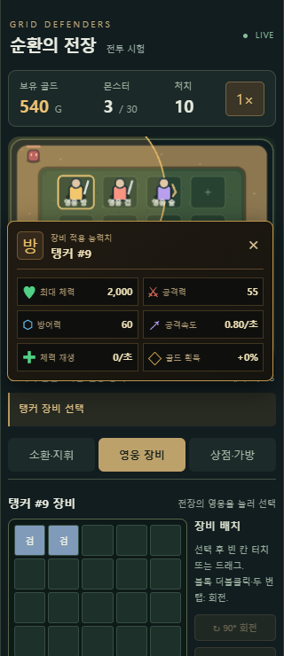
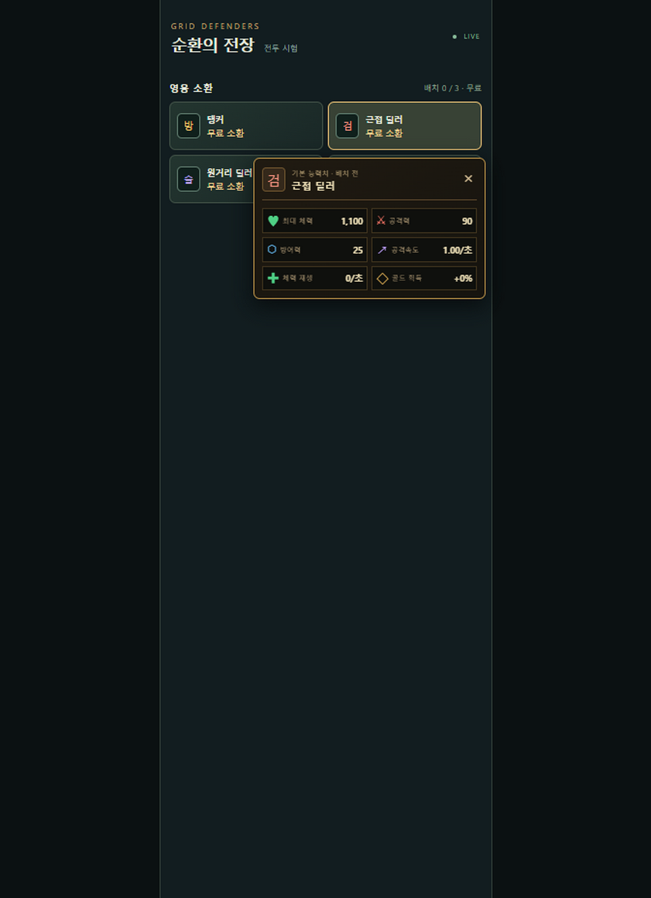

- E: 영웅 클릭 위치를 기준으로 위 또는 아래에 작은 정보창. 화면 밖으로 넘치지 않게 위치 보정.
- B의 배치 영웅 클릭: 장비 적용 능력치 + C-2 자동 선택. C-2 제목에 영웅 이름·번호.
- C-1의 미배치 영웅 카드 클릭: 기본 능력치 + 소환 선택. 카드 자체는 약62px 높이로 축소.
- 이미 배치된 카드 선택은 해당 전장 영웅으로 연결. 정원이 가득해도 미배치 정보 확인 가능.
- 기존 C-2 영웅 선택 버튼·능력치 줄 제거. 영웅 정보는 E에만 표시.
- 최대 체력/공격력/방어력/공격속도/재생/골드 획득을2열 배치, 현재 구현값만 사용.
- 닫기·바깥 클릭·Escape·메뉴 변경으로 닫힘. 전투 중단 없는 비모달 정보창.
- 카드 이미지는 영웅 소환 영역을 잘 보여주기 위해 별도 QA 탭에서 다른 영역을 숨긴 발췌 캡처. 원래 게임 탭의 구성·화면 크기는 변경하지 않음.
- 아래 스크린샷은 이전 UI 이력이며 현재 화면은 이 절 우선.

## WEB-004 현재 변경

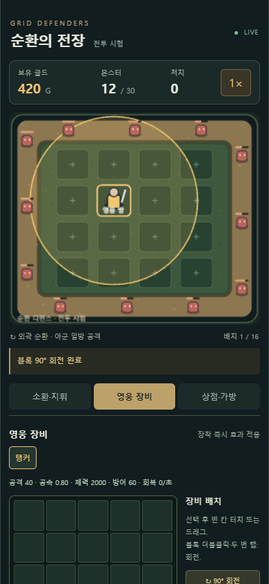
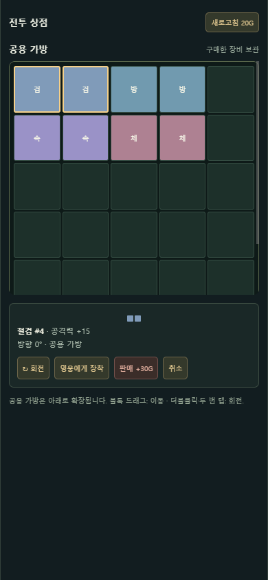

- B: 선택 영웅 공격 범위를 더 진하게 표시. 유닛 드래그로 이동·서로 자리교체.
- B 영웅 클릭 → C-2의 해당 영웅 장비창 자동 선택. 드래그 이동 시 메뉴 자동 변경 없음.
- B 전투 이펙트: 보병 부채꼴, 마법병 대상 중심 원형. 표시 영역과 판정 일치.
- C-2: 영웅 장비칸·공용 가방 블록 더블클릭/두 번 탭 회전.
- C-3: 공용 가방은5열 테트리스 격자, 세로 스크롤·행 확장. 구매품 자동 배치.
- C-3 블록 선택은 상점을 유지, ‘영웅에게 장착’으로 C-2 전환.
- 장비 선택 후 빈 칸 클릭 또는 드래그. 회전 불가 위치에서는 원래 상태와 안내 유지.
- 가방 이미지는 별도 QA 탭에서 가방 부분을 보여주기 위해 다른 영역을 일시 숨긴 발췌 캡처이며 실제 화면 구성 변경이 아님. 원래 게임 탭에는 해당 캡처 설정을 적용하지 않음.
- 아래 v001 및 개발자창 이미지는 이전 상태 참조용. 현재 변경 사항은 이 절 우선.

## WEB-003 추가: D — 임시 개발자 기록창

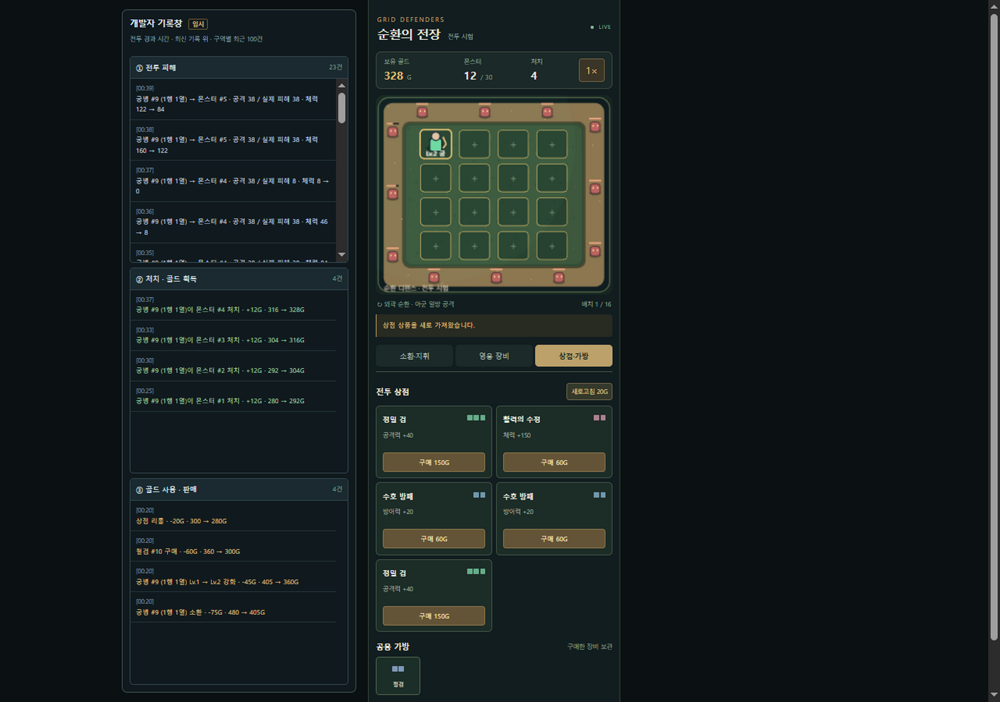

- D-1: 피해 기록. 누가 누구를 공격했는지, 공격값·실제 체력 감소량과 체력 전후.
- D-2: 처치·골드 획득. 처치자와 대상, 보상과 잔액.
- D-3: 골드 사용·판매. 이유와 증감·잔액.
- 넓은 화면에서는 게임 왼쪽 여백, viewport1080px 미만에서는 게임 아래.
- 구역별 독립 스크롤, 최근100건·최신 위. 실제 전투 시간 기준.
- 유저가 지정한 임시 개발 확인용 영역이며 최종 게임 UI에 포함하는 결정이 아니다.
- 스크린샷의 숫자는 시험 시점의 예시다. 문서 아래 A/B/C는 기존 전투 UI를 설명한다.

상태: REF-06 구역을 참고한 임시 구현, 유저 시각 피드백 대기.

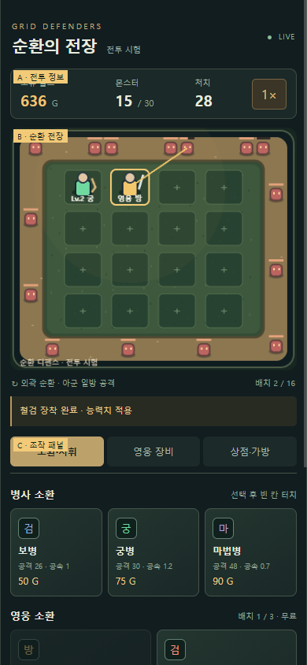

- A: 보유 골드·몬스터 수·처치 수·배속. 페이지 상단.
- B: 바깥 사각 경로로 몬스터 순환. 내부4열×4행 유닛 배치. 선택한 유닛 사거리 표시.
- C: 하단 조작 메뉴. 소환·지휘 / 영웅 장비 / 상점·가방 탭으로 전환.
  - C-1 소환·지휘: 병사3종, 영웅4종 후보, 선택 유닛의 강화·판매.
  - C-2 영웅 장비: 영웅 탭, 현재 수치, 5×6칸, 회전·해제, 공용 가방.
  - C-3 상점·가방: 상품5칸, 리롤, 구매 장비.

예: “B 영역의 배치 칸 간격을 줄여줘”, “C-2 장비창을 더 크게 해줘”.

기술 기준: 페이지 최대430 CSS px, 전장390×330 논리px, 모바일 폭에 비례 축소. 패널은 세로 스크롤. 스크린샷은390px 폭의 일부 화면이며 아래 영역은 스크롤로 볼 수 있다.
↳ 쉽게 말하면: 휴대폰 폭에 맞춰 전장이 줄어들고, 하단 메뉴가 길면 내려서 본다.

이미지의 유닛·골드 수는 검증 시점의 예시이며 초기 배치·재화 규칙을 의미하지 않는다. 이미지는 실제 브라우저 화면에 구역 라벨을 얹어 캡처했고 라벨은 게임 실행 화면에 남기지 않는다.

## WEB-006 현재: F — 개발 도구·조합 공식

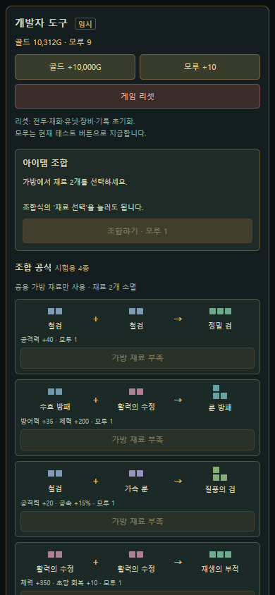

- F: 넓은 화면의 게임 오른쪽 여백. 골드+10,000·모루+10·전체 시험 상태 리셋.
- F-1: 재료 선택2칸·결과 미리보기·조합 실행. 공식의 ‘재료 선택’은 가방 재료를 찾아 선택하며 소비는 조합 버튼에서만 수행.
- F-2: 네 조합식을 재료 블록 모양+이름 → 결과 블록+이름으로 표시. 아래 효과·모루 비용·재료 부족 표시.
- 화면 폭1080px 미만은 게임 아래에 표시. 패널 세로 스크롤로 전체 확인.
- E 팝업은 병사도 지원. 배치 전 기본 수치, 배치 후 강화 적용 수치.
- C-2: 겹침·경계 밖 장비는 빨간 무늬 및 비활성 표시. 장비 목록에서 상태 확인·가방 회수 가능.
- WEB-004의 ‘회전 실패 시 유지’는 공용 가방에만 유지. 영웅 장비칸은 회전·겹침을 허용하는 WEB-006 규칙 우선.
- 이미지는 별도 QA 탭에서 개발 도구만 보이도록 다른 영역을 일시 숨긴 발췌. 숫자는 검증 예시이며 원래 게임 탭의 화면 크기는 변경하지 않음.

## WEB-007 현재: C-2 조합 영역·접촉 안내

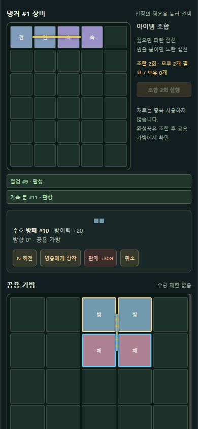

- C-2 오른쪽: 기존 회전·해제 대신 조합 횟수·모루 필요/보유·일괄 실행 버튼. 완성품 정보 미리보기 없음.
- 노란 실선: 현재 격자에서 조합식이 맞고 블록 변이 붙은 재료 쌍. 대각/겹침 제외.
- 파란 점선·상대 테두리: 짚은 아이템의 조합 상대 안내. 상점 상품도 지원. 화면의 공용 가방에서 노란 선과 파란 점선이 함께 보이는 것은 접촉 쌍을 선택한 상태.
- C-3 상점 상품을 공용 가방에 드롭하면 구매. 화면/가방 가장자리에서 드래그 스크롤 지원.
- F 개발 도구는 재화 지급·리셋 유지, 조합식·결과 능력치 목록 제거. 별도 도감은 후속 계획.
- 이미지는 별도 QA 탭에서 장비 패널만 보여주는 발췌. 일반 화면의 상단 전장·개발 도구를 제거한 것이 아님. 원래 게임 탭 화면 크기 유지.
- 이전 WEB-006의 공식/미리보기/재료 선택 영역 설명은 이 절로 대체.

## WEB-008 현재: 조합 표시·완성 위치·C-3 순서

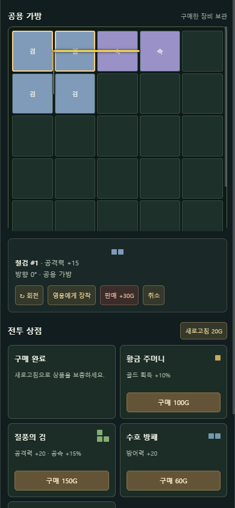

- 파란 점선은 누르는 동안만. 놓기·취소·창 포커스 상실로 제거, 선택 상태로 재표시하지 않음.
- 노란 선은 이번 실행 대상, 회색 선은 재료를 공유해 이번에 실행되지 않는 후순위 후보. 후순위 아이템 능력치는 그대로 유지.
- 완성품은 해당 장비칸/가방의 첫 재료 위치와 방향에 배치. 공용 가방 공간 부족이면 재료·모루 보존 후 안내. 영웅 장비의 겹침·경계 비활성 규칙 유지.
- C-3: 공용 가방 → 선택 상세 → 전투 상점. 이미지의 회색 선은 왼쪽 철검과 그 아래 철검을 연결, 노란 선은 위 철검과 가속 룬을 연결.
- 이미지는 별도 QA 탭에서 C-3 패널만 표시한 발췌. 실제 상단 전장을 삭제한 것이 아니며 기존 게임 탭 크기 유지.
- WEB-007의 선택 중 지속 점선·모든 후보 노란 선·완성품 가방 자동 이동 설명은 이 절로 대체.

## WEB-009 현재: F-2 개발자 조합 공식 트리

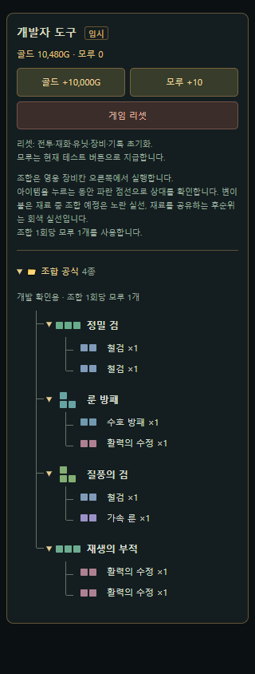

- F 개발자 도구의 기존 안내 아래 F-2 ‘조합 공식’. 완성품 폴더 아래 재료 두 가지를 가지로 표시.
- 전체·완성품별 접기/펼치기 지원. 화면 갱신·개발 버튼 사용에도 접힌 상태 유지.
- 기존 네 조합식 데이터 사용. 별도 도감이 아니며 장비창 결과 미리보기는 추가하지 않음.
- 이미지는 별도 QA 탭에서 개발 도구만 표시한 320px 발췌. 원래 게임 탭 화면 크기 유지.

## WEB-010 현재: 블록 드래그·배치 잔상

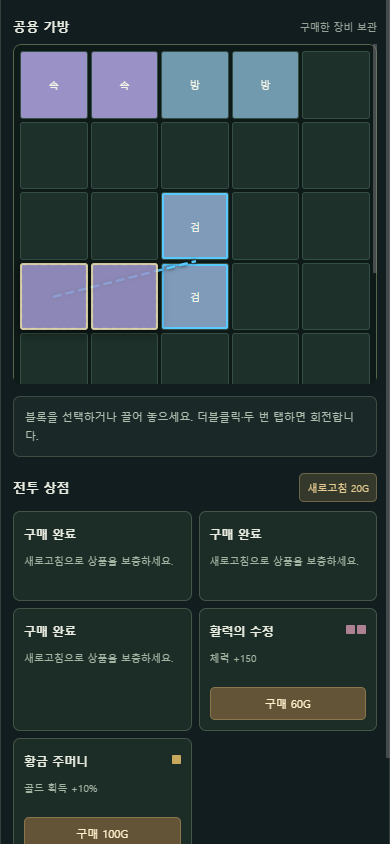

- 아이템 이름표 대신 실제 색·모양·회전 방향의 블록이 포인터를 따라옴.
- C-2/C-3 가방·장비칸 위의 예상 칸에 반투명 잔상. 집은 블록 칸 유지.
- 붉은 잔상은 가방 배치 불가 또는 영웅 비활성 예상. 상점은 기존 자동 빈 곳 배치 위치를 표시.
- 놓기·취소·창 전환 시 잔상 제거. 스크롤·창 크기 변경 반영, 화면 밖은 클립.
- 이미지는 QA 탭에서 상점 패널만 보이게 한390px 발췌. 원래 게임 탭 크기 유지.

## WEB-011 현재: 경계 보정·판매·영웅 자동 장착·승급

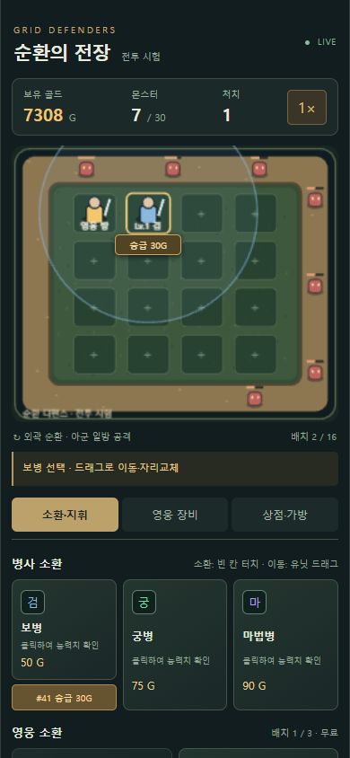
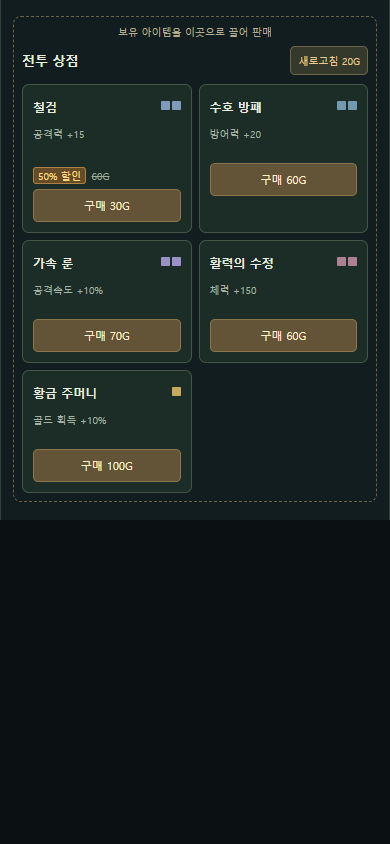
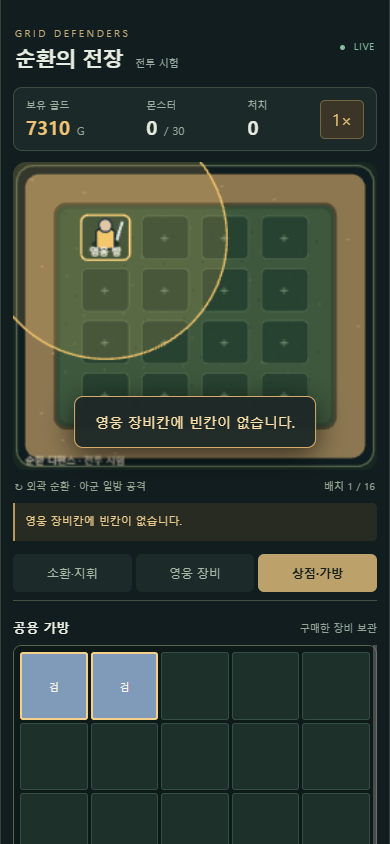

- B-1: 선택 병사 바로 아래 승급 버튼. C-1의 해당 종류 카드 아래 같은 병사 번호의 승급 버튼. 기존 강화 비용·상한 유지.
- C-3 상점 점선 테두리 영역에 보유 장비 드롭 → 판매. 드래그 중 강조와 환급액 안내.
- 상품별 초기·리롤·리셋 때20%로 반값 할인. 정상가 취소선·50% 표시·실제 구매가. 능력치 감소 없는 가격 할인.
- C-3 가방 장비를 B 영웅에게 드롭 → 빈칸 자동 활성 장착. 공간 없으면 중앙 안내, 가방 아이템 유지.
- 경계 밖 잔상은 가장 가까운 비충돌 위치로 보정, 실제 드롭과 일치. 방향 유지. 공간 없으면 원상태.
- 상점 사진은 상품·할인 추첨을 QA에서 고정하고 상점 부분만 표시한 설명용 발췌. 게임 소스의20% 확률은 그대로. 나머지는 실제 QA 화면. 기존 게임 탭 크기 유지.
- 이전 문서의 경계 밖 고정 비활성 설명은 이 경계 보정 규칙으로 대체. 칸 내부 겹침 비활성은 유지.

## WEB-012 현재: B-2 현상금 버튼·피해 숫자·병사 잔상

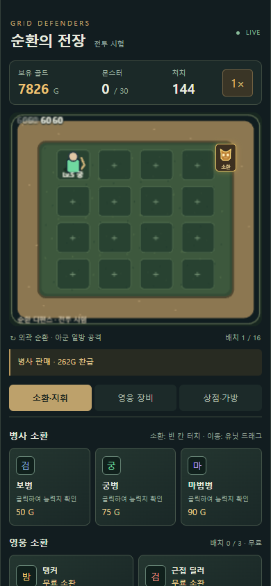
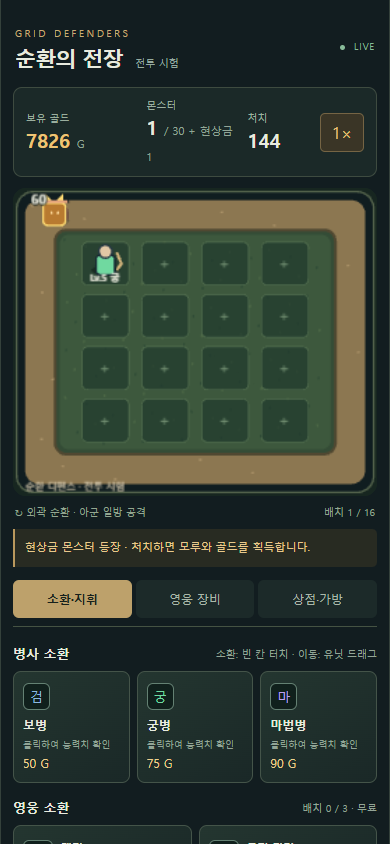
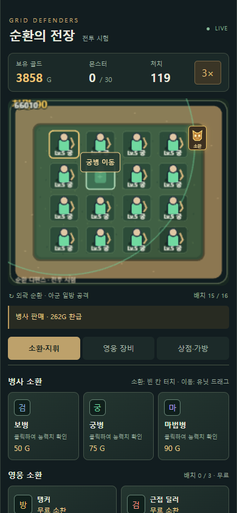
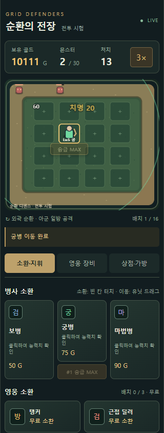

- B-2: 전장 오른쪽 위, 몬스터 길 안쪽 고정. 일반50처치마다 기회1회, 버튼으로 즉시 소환. 대기 회수 누적, 활성1마리 제한.
- 현상금은 큰 금색·뿔 모양, 기본 모루1·100G. 그림의 골드/처치 수는 시험 상태.
- 타격 숫자는 실제 체력 감소량. 치명타는 큰 노란색. 마지막 이미지의 난수는 표시 확인을 위해 QA에서 잠시 고정, 게임의10% 확률 유지.
- 병사 드래그 목표 칸은 밝은 테두리·반투명 실루엣. 원래 병사는 놓기 전 유지.
- 앞 세 이미지는 숫자 가장자리 표시/HUD 줄바꿈을 최종 보정하기 전 캡처, 위치·몬스터·이동 잔상 기준은 동일. 최종 숫자 표현은 마지막 이미지 우선.
- 기존 게임 탭 viewport·서버 유지, 별도 QA 탭에서 촬영.

## WEB-013 현재: C-2 영웅 장비4×5·목록 제거

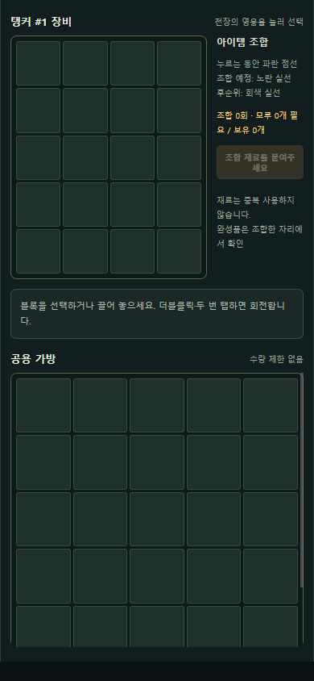

- 영웅 장비는 가로4·세로5=20칸. 공용 가방은 기존5열 유지.
- 장착 아이템 이름/활성 상태를 나열하던 목록 제거. 블록 선택 상세와 비활성 색상 유지.
- 자동 배치·조합·경계·잔상은 새 규격 반영. 이전5×6/장착 목록 설명은 이 절로 대체.
- 이미지는 별도 QA 탭의 장비 패널 발췌, 기존 게임 탭 크기 유지.
